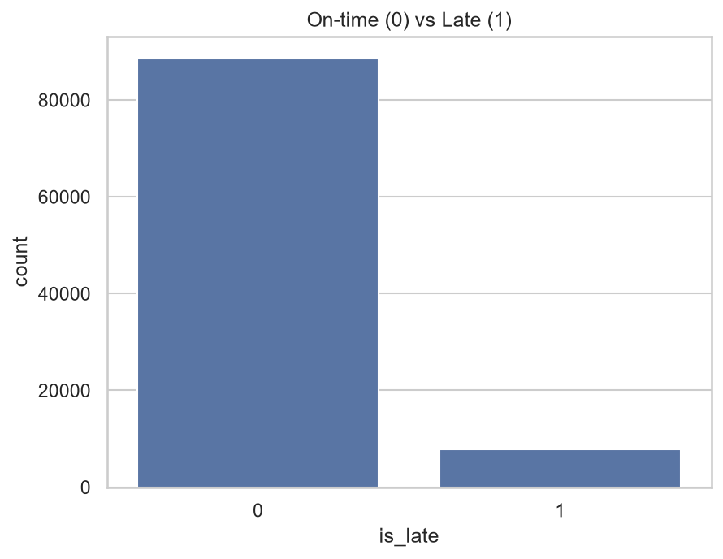
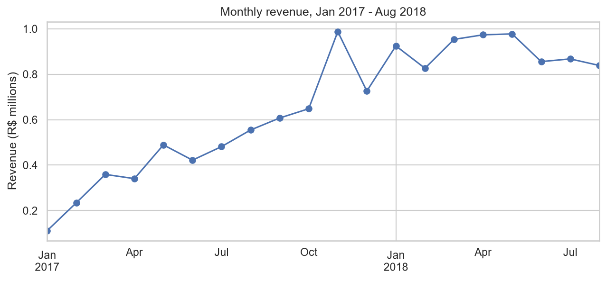
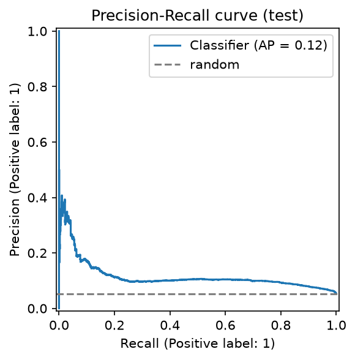
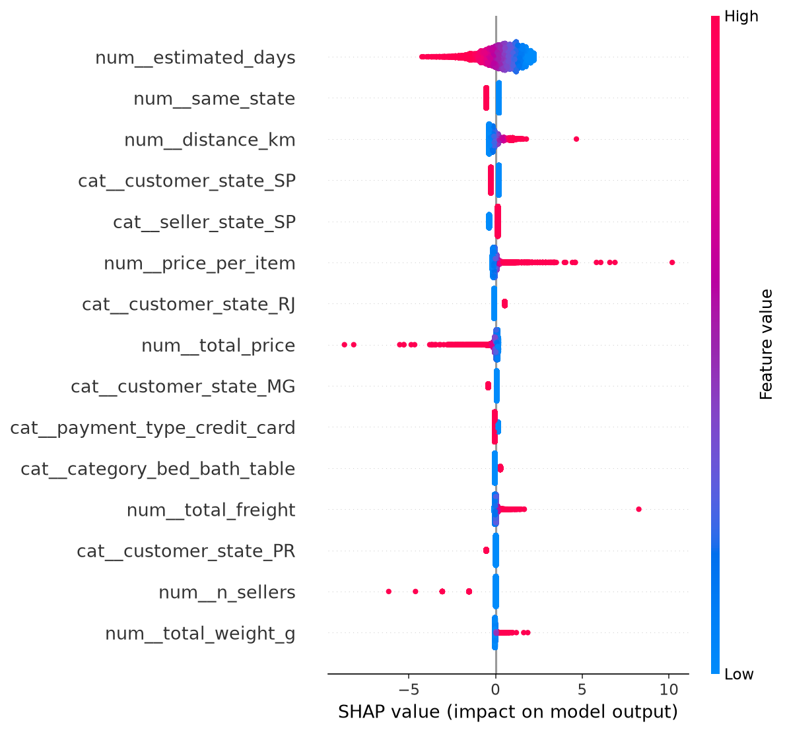

# Olist Late-Delivery Prediction: Project Report

## 1. Problem and business value
Olist is a Brazilian e-commerce marketplace. When an order arrives after its estimated date, customers react badly: the average review score falls from **4.29 (on-time)** to **2.57 (late)**. The goal is to predict, **at purchase time**, whether an order will be late, so the business can warn customers or prioritize shipments early.

**Target:** `is_late = 1` if the delivered date is after the estimated delivery date.

## 2. Data and why it was chosen
Olist Brazilian E-Commerce Public Dataset (Kaggle): 9 real, anonymized tables, about 100k orders, 2016-2018.
It was chosen because it is real (messy, not synthetic), multi-table (requires joins), imbalanced, and covers numeric, date, text and geographic data.

## 3. Cleaning decisions
- Kept **delivered orders with a delivery date** only (96,470), because the target needs a real delivery date.
- Dropped 2016 (sparse): 96,203 orders used for modeling.
- Aggregated items, payments and reviews to **one row per order** before joining, with a row-count check after every join.
- Reduced geolocation to one point per zip prefix (median).
- Zero weight (22 orders) and zero volume (16 orders) were treated as **missing**, not real values.
- Outliers were **kept**: very late deliveries are real events the model must learn.
- Review score and delivery days were used for analysis only, never as features (they are known after delivery = leakage).

## 4. Exploratory findings
- **8.1%** of orders are late (strong class imbalance, so accuracy is a misleading metric).
- Olist pads its estimates: estimated **23.4 days** vs actual **12.1 days**.
- Late rate rises with distance: about **6.5%** (closest fifth) to about **11%** (farthest fifth).
- Geography matters most: **AL (about 24%)** and **MA (about 20%)** are worst; **PR, MG, SP (about 5-6%)** are best.
- Product category matters little (top categories sit in a narrow 8.5-10% band).
- Revenue grew through 2017 and peaked in **Nov 2017** (Black Friday), then plateaued.

## 5. Method
- **Time-based split:** train Jan 2017 to May 2018 (76,962 orders), test 27 May to 29 Aug 2018 (19,241 orders). This mimics predicting future orders from past ones.
- Features known at purchase: estimated days, distance, price, freight, weight, volume, items, installments, states, category, payment type, purchase month/weekday/hour, plus engineered ratios.
- **Pipeline fitted on train only** (median imputation, scaling, one-hot encoding) to avoid leakage.

## 6. Models and why
Baseline first, then more complex models:
- **Logistic Regression:** simple, fast, explainable.
- **XGBoost:** strong on tabular, nonlinear data.
- **Random Forest:** robust to outliers and mixed features.

Not used: KNN and SVM (slow at this size), neural networks (too little data, hard to explain).

## 7. Results (test set)

| Model | PR-AUC | ROC-AUC | Precision @ top 10% | Recall @ top 10% |
|---|---|---|---|---|
| Random baseline | 0.053 | 0.500 | 0.053 | 0.100 |
| **Logistic Regression (final)** | **0.116** | **0.722** | 0.112 | 0.212 |
| XGBoost | 0.107 | 0.713 | 0.116 | 0.219 |
| Random Forest | 0.062 | 0.531 | 0.076 | 0.143 |

**Decision rule:** flag the riskiest 10% of orders (a stable workload even when the late rate drifts).
Result: 1,925 orders flagged, **216 of 1,020 late orders caught (recall 21%, precision 11.2%)**, about **2.1x better than random**.

**Interpretation:** the model is a weak but real triage tool. It is suitable for cheap actions (proactive "your order may be delayed" messages), not for costly interventions.

## 8. Drift test
The late rate fell from **8.8% (train)** to **5.3% (test)**, with spikes in Nov 2017 and Feb-Mar 2018. Random Forest performed near random (ROC-AUC 0.53).

**Hypothesis:** `purchase_month` lets trees memorize train-period events.
**Result: rejected.** Removing it made XGBoost worse (PR-AUC 0.107 to 0.083) and did not fix Random Forest. The month carries real seasonal signal. The cause of the Random Forest failure remains undiagnosed.

## 9. Drivers of late delivery
Strongest effects (Logistic Regression coefficients):
- **Raise risk:** seller state MA, customer state AL and RJ, categories audio and christmas_supplies.
- **Lower risk:** customer state RO, seller state PE, longer `estimated_days` (Olist's padding acts as a buffer), categories computers and market_place.

Geography dominates, consistent with long distances to the Northeast. Coefficients show association, not cause. Small states rest on few orders, and `christmas_supplies` likely reflects the Nov-Dec peak, not the product itself. `total_price` and `price_per_item` are highly correlated (0.93), so their separate coefficients are unreliable.

## 10. Limitations and next steps
**Limitations**
- Weak signal: seller speed, stock and carrier delays are unknown at purchase time.
- Distribution drift between train and test periods.
- `class_weight="balanced"` inflates scores: use them to **rank** orders, not as true probabilities.
- 1,275 multi-seller orders use only the first seller's location.
- Single time-based split; no cross-validation or tuning.

**Next steps**
- Add seller history features (past late rate, average handling time).
- Time-based cross-validation and calibration.
- Retrain monthly and monitor drift.
- Drop redundant `price_per_item`.
- Add customer segmentation (RFM) and review-text analysis.
